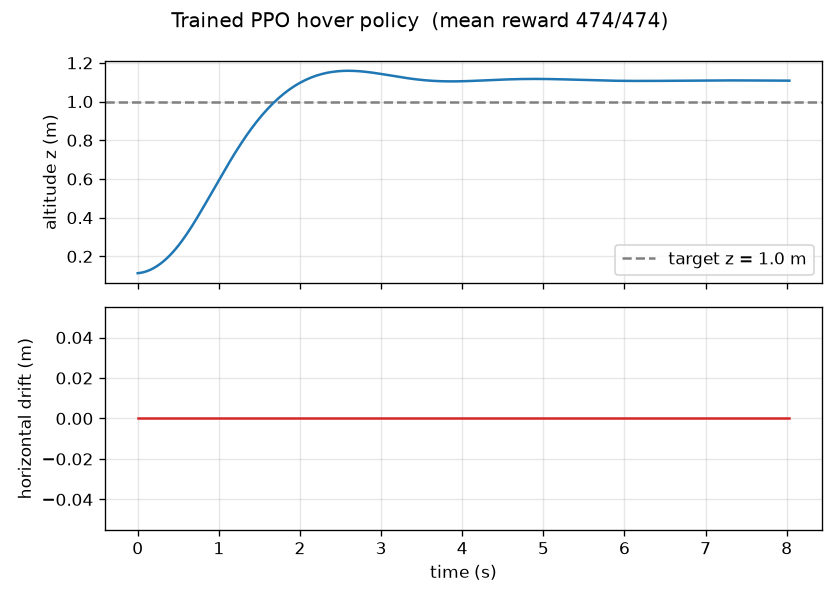

# Drone RL, Assignment 3 (CMS)

A simulated quadrotor (PyBullet, via [`gym-pybullet-drones`](https://github.com/utiasDSL/gym-pybullet-drones),
trained with [Stable-Baselines3](https://github.com/DLR-RM/stable-baselines3)) that learns two
things: how to hover, and how to **take off from the floor, find a hoop and fly through it** inside
a 2x2x2 m net. The simulated cage mirrors the real one used for the hardware demo (a 2x2x2 m net
with a ring near its centre that sways a little in the wind), so a policy trained here can be flown
on a real DJI Tello.

Everything can be driven from a local **web dashboard**: set up and start training, watch the
drone fly in 3D (far view and drone camera), play back what the current policy has learned, and
compare the sim against the phone scan of the real cage.

---

## Quick start (for teammates)

You need **Git**, **Miniconda** and a C++ compiler (Windows: Visual Studio Build Tools, "Desktop
development with C++"). No GPU is needed. Total setup is about 20 minutes, mostly compiling PyBullet.

```bash
# 1. Get this repo (the 33 MB phone scan in assets/ comes with it)
git clone https://github.com/MichelleGun/CMS.git
cd CMS

# 2. Build the Python environment `drones` (simulator, PyBullet, PyTorch, Stable-Baselines3).
#    Follow SETUP.md steps 1-4; the short version is:
#       git clone https://github.com/utiasDSL/gym-pybullet-drones.git   (next to this repo, not inside it)
#       conda create -n drones -c conda-forge --override-channels python=3.12 -y
#       conda activate drones
#       conda install -c conda-forge --override-channels pip setuptools wheel -y
#       cd ../gym-pybullet-drones && pip install -e . && cd ../CMS

# 3. Add the dashboard's packages to the same environment
conda activate drones
pip install -r webapp/requirements.txt

# 4. Start the dashboard (run it from the CMS folder, inside the `drones` environment)
python -m uvicorn main:app --app-dir webapp/backend --port 8000
```

Then open **http://localhost:8000** in a browser (it needs an internet connection: the 3D
view loads three.js from a CDN). Stop the server with `Ctrl+C`. Never add `--host 0.0.0.0`: the
dashboard can fly a real drone and should only be reachable from your own computer.

**First things to try**

1. **Environment** tab: the simulated net and ring. *Randomise ring* shows the per-episode
   variation, *Wind sway* the swinging, *Play example flight* a take-off through the ring, and
   *Overlay phone scan* lays the real cage's scan over the sim net (fitted automatically).
2. **Simulator** tab: choose *Net + ring*, an algorithm and *Fixed* or *Until I click Stop*
   (for overnight runs), then **Start training**. The run view shows the far view with the drone's
   route, the drone's camera, and **Watch current policy** plays one episode with what it has
   learned so far. A *Real-time* checkbox slows everything to real speed so you can follow it.
   By default episodes are varied so the policy gets robust. About 70% start where the previous
   episode ended (as if the drone landed there), the rest anywhere on the floor. Half are flown back
   to front, and about 30% have the ring leaning the other way, as if the wind held it over. Each has a
   checkbox in the Training panel (and `--carry-start`, `--reverse-prob`, `--lean-flip-prob` on
   `scripts/train_hoop_multi.py`).
3. Training saves into `results/hoop/runs/<run id>/` (not committed to git). `latest_model.zip` is
   updated at every evaluation and `best_model.zip` on each new best, so an interrupted run keeps
   its progress.

**Good to know**

- The dashboard starts training in a separate process, so **keep the server window open** while a
  run trains (closing it ends the run). For overnight runs also keep the laptop plugged in; while an
  *Until I click Stop* run trains, Windows is kept from sleeping.
- Training speed depends on your CPU. A 1M-step run takes a few hours on a laptop; around 100-150
  simulation steps per second is typical. With the dashboard's 3D view open it is a little slower.
- If something looks stale after pulling new code, press **Ctrl+F5** in the browser and restart
  the server.
- Windows is what this was developed on. macOS/Linux should work (the same Python code), but the
  *Stop* button and sleep-prevention are only tested on Windows.
- Without a real Tello nothing in `hardware/` is needed. The **Drone** tab has a simulated drone for
  dry runs.

---

For a full, step-by-step guide to recreating this entire system from nothing, see
[tutorial/TUTORIAL.md](tutorial/TUTORIAL.md). For exact environment setup commands, see
[SETUP.md](SETUP.md). For the full chronological build log and open questions, see
[PROGRESS.md](PROGRESS.md).



---

## How to run it

This assumes the `drones` conda environment already exists and `pip install -r
webapp/requirements.txt` has been run in it (see the quick start above). If the environment doesn't
exist yet, start with [SETUP.md](SETUP.md) or [tutorial/TUTORIAL.md](tutorial/TUTORIAL.md).

### The web dashboard (easiest way to play with it)

A local website with a live 3D view of the drone and hoop, a choice of training algorithm,
start/stop controls, a reward chart, an onboard drone camera, and video replay. No coding needed
once it's running.

```bash
conda activate drones
cd path/to/CMS
python -m uvicorn main:app --app-dir webapp/backend --port 8000
```

Then open `http://localhost:8000` in a browser. Stop it with Ctrl+C.

If `uvicorn` is on your PATH, `uvicorn main:app --app-dir backend --port 8000` (or
`cd backend && uvicorn main:app --port 8000`) also works. If the plain `uvicorn` command isn't
found even after `conda activate drones`, use the `python -m uvicorn` form above instead, that's
the one confirmed to work regardless of PATH quirks.

What the Simulator tab gives you while a run trains:
- **Live far view and drone POV**, for PyBullet net runs and for onboard-camera runs. The HUD
  shows this episode's ring swing (`ring swing this episode 18° of 45° max · wind ramp 47% ·
  period 2.1 s`), which is wind ramp × a per-episode gust × the "Ring swing" slider, so the ring
  can look gentle even at the maximum setting early in a run.
- **Reward (MDP) block** in the Training panel: the mode (shaped / budget), passes per episode or
  the budget, and every weight, with a one-line summary and a reset button. Starting from an
  earlier run pre-fills its reward and warns if you change it (the critic has to re-fit). The run
  view shows a read-only **Reward** card; the weights are saved in `meta.json`.
- **Run names and stars.** Every run shows its date and time. Rename it with ✎ and mark keepers
  with ★ (kept in `label.json`, so the trainer never overwrites it). The **best run** is the one
  with the highest eval **success rate** on today's env, not the highest reward (reward is not
  comparable between shaped and budget runs). It is green with a BEST tag, listed first in
  "Start from", and the History tab can filter to best and starred runs.
- **Best** replays the open run's own best policy on a fresh random ring, start and wind each time
  (every replay takes a new seed). History → "Open this run" opens it here.
- A locked Training panel (a run is loading, or no cores are free) is greyed out and says why.
- Onboard-camera runs have no PyBullet replay, so Watch and Best are disabled for them with a note.

Full feature list and notes: [webapp/README.md](webapp/README.md).

### From the command line

| Script | What it does |
|---|---|
| `scripts/quickstart_train.py` | Trains the hover policy (PPO, stops early once solved). |
| `scripts/quickstart_eval.py` | Evaluates the saved hover policy and regenerates the trajectory plot. |
| `scripts/fly_in_court.py` | Flies the drone around a virtual basketball court (PID tour, or the RL hover policy). |
| `scripts/train_hoop_find.py` | Trains the hoop-finding policy (PPO only, writes to `results/hoop/`). |
| `scripts/fly_hoop_demo.py` | Watches the trained hoop-finding policy; the hoop moves to a new spot every episode. |
| `scripts/train_hoop_multi.py` | Same hoop task, with a choice of algorithm and a run-scoped output folder. This is what the webapp itself calls, and it also works standalone from the terminal. Defaults to the net + ring environment (`--env net`); `--env legacy` trains the original point-reaching task. |

Run these from `scripts/` with `drones` activated. Full walkthroughs and explanations of each are
in [tutorial/TUTORIAL.md](tutorial/TUTORIAL.md).

### The notebook

`tutorial/walkthrough.ipynb` already has training curves, full rollout diagnostics, and embedded
video for both tasks baked in. Re-run it with
`jupyter nbconvert --to notebook --execute --inplace tutorial/walkthrough.ipynb` if you want fresh
numbers after retraining.

---

## Which file to edit for what

```
CMS/
├── scripts/       drone environments, training scripts, and shared helpers
├── webapp/        the local web dashboard (FastAPI backend + browser frontend)
├── hardware/      flying the policies on a real DJI Tello (see hardware/README.md)
├── tutorial/      TUTORIAL.md and the runnable notebook
├── assets/        the basketball court texture and the phone scan of the real cage (3D_net&hoop.glb)
└── results/       trained models, evaluation logs, videos, and webapp run data
```

| Want to change... | Edit... |
|---|---|
| Net size, ring size/position/facing and its per-episode jitter, net bounce, reward (the default training env) | `scripts/hoop_net_env.py` (`HoopSpec`) |
| The original point-reaching task (`--env legacy`) | `scripts/hoop_env.py` |
| Hover task behaviour | `scripts/quickstart_train.py` (the environment itself, `HoverAviary`, lives in the installed `gym-pybullet-drones` package, not this repo) |
| Basketball court geometry or markings | `scripts/court.py` |
| Add or change a training algorithm in the webapp | `webapp/backend/config.py` (the algorithm list) and `scripts/train_hoop_multi.py` (`ALGO_CLASSES`) |
| What gets logged during training (telemetry, camera, eval snapshots) | `scripts/telemetry_callback.py` |
| Onboard camera capture | `scripts/camera_capture.py` |
| Replay video generation | `scripts/replay_hoop.py` |
| Webapp API, subprocess start/stop | `webapp/backend/main.py`, `webapp/backend/run_manager.py` |
| Webapp interface (3D view, controls, chart) | `webapp/frontend/index.html`, `webapp/frontend/js/*.js` |
| The Reward (MDP) editor and card | `webapp/frontend/js/reward.js` (defaults come from `DEFAULT_REWARD_WEIGHTS` in `scripts/hoop_net_env.py`, via `GET /api/config`) |
| Onboard-camera task: what is randomised (drone, swinging ring, hard starts, detector noise) | `hardware/onboard/sim.py`; tests in `hardware/onboard/tests/test_robust.py` |
| 3D scene shared by the CLI and the webapp's replay generator | `scripts/court.py` (`build_room`, `build_hoop`) |
| Anything about the real Tello: safety limits, calibration, camera, keyboard flying, imitation, running a policy | `hardware/` (settings in `hardware/config.yaml`) |

---

## Real hardware (DJI Tello)

`hardware/` runs the simulator's policies on a Tello in the 2x2x2 m cage: keyboard flying, loading a trained policy,
recording demonstrations for behaviour cloning, an overhead-camera plus dead-reckoning position estimate, and
emergency-stop / safe-landing keys. It reproduces the simulator's 75-number observation exactly (checked against the
real environment) and is fully testable without a drone. **It has not flown a real Tello yet.**
[hardware/README.md](hardware/README.md) has three parts: what the folder is for, a step by step beginner
walkthrough (start here, it begins with steps that need no drone), and a full explanation of what is inside, why,
and how it was made.

```
python hardware/control/keyboard_teleop.py --dry-run          # fly a simulated Tello with the keyboard
python -m pytest hardware/tests -q                            # offline checks
```

---

## Results so far

### Hover

| Steps | Mean reward |
|------:|------------:|
| 8k    | 336 |
| 16k   | 441 |
| 40k   | 219 (PPO instability, recovered) |
| 104k  | 466 |
| 152k  | 474 |
| 160k  | 474, early stop |

Final policy (20 episodes): **474.1 ± 0.0**. The drone climbs to 1.0 m and holds it with
millimetre-scale drift.

### Hoop-finding (hardware-demo cage)

Evaluated over 20 episodes with fresh random hoop and start positions, not seen during training.

| | First attempt (`pid`, 400k steps) | Current (`vel`, 500k steps) |
|---|---:|---:|
| Reached the hoop | 0/20 | **9/20** |
| Mean final distance to hoop | 0.84 ± 0.34 m | **0.34 ± 0.22 m** |

Those numbers are for the legacy point-reaching task. 

### Net + ring environment (`scripts/hoop_net_env.py`)

This environment mirrors the real cage. It has a 2×2×2 m net with a hanging ring (0.30 m opening, measured from the phone scan) near the centre. Every episode varies the ring's position, facing and size to cover repositioning. The drone's prop wash pushes the ring away as the drone comes close, and there is a little residual swing about the rope knot at its top. Training runs start the drone **hovering at about 0.8 m**, where the real Tello hands over to the policy after takeoff. Success means flying through the opening in the required direction, again and again.

**The MDP now (v4, since 2026-10-11 night):**

| Part | v4 setting |
|---|---|
| State / observation | **83** numbers: drone state (12), the last 15 actions (60), the ring's facing (3), velocity (3) and opening radius (1), **the lap "armed" flag (1)**, and the vector to the ring (3) |
| Action | unchanged: velocity direction + speed fraction, up to about 0.25 m/s |
| Start | hovering at 0.8 ± 0.1 m (`--start-z 0.8`; `--start-z 0` = the old floor start) |
| Ring | pushed away by prop wash, up to 15° of tilt about the rope (`--wash-deg`), plus up to 5° of residual swing (`--sway-deg`) |
| Reward (`--reward budget`) | −0.005 per step, **+5 per pass** (`budget_pass`), −0.05 per rim clip, **plus potential-based shaping, 2 per metre** (`--budget-shape`) |
| Passes | never end the episode. After each pass the required direction flips (back-and-forth). The next pass counts once the drone has flown 0.28 m clear of the ring (re-armed) |
| Termination | the time, pass, rim and net terms (shaping excluded) reach **−budget** (10), **or** the drone touches the net, **or** the drone tips over, **or** 120 s pass (a safety cap) |
| Net | touching it ends the episode, and the reward drains whatever budget is left |

#### MDP changes and why

| Version | Runs | What changed | Why |
|---|---|---|---|
| v1 | `ppo_20261010-093427` | 78-number obs. Shaped reward: progress to waypoints +10/m, +20 per pass, rim and net −1 with a bounce. One pass ends the episode. PPO defaults | starting point |
| v2 | `ppo_20261010-182515` | Obs +ring velocity and radius (82). Potential-based shaping with an axis pull. Pass +20, plus up to +10 for a centred one. Rim −3, net ends the episode with −5. Wind ramp-up. Stabilised PPO settings | v1 stalled at about 6% success: PPO overwrote itself every update, the policy couldn't see the ring swing, and the wind was at full strength from step 0 |
| v3 | `ppo_20261011-013455`, then `ppo_20261011-024000` / `-025335` / `-032617` / `-023958` / `-212417` (budget 10, +5 per pass, sway 20°, continued each time) | The budget reward: passes don't end the episode, and there is no shaping | v2 learned to **park 18–31 cm in front of the ring** (0% passes after 14.5M steps). Under v3 the eval success rate stayed at 0–40%, and **no evaluation ever saw a second pass** (`max_passes` 1 in every run, 38M steps) |
| v4 | `ppo_20261011-221214` (continued from `-212417` at 38.0M steps) | The lap "armed" flag in the observation (82 → 83). Potential-based shaping added back on top of the budget. Hover starts. The prop-wash ring, with the swing cut from 20° to 5° | See "Why each v4 change was made" below: the policy could not tell when a second pass would count, had no signal for the turn back, and parked in 7 of 10 episodes |

Why each v4 change was made. I ran `ppo_20261011-212417` (v3, 37M steps) on 10 evaluation
episodes and traced what it did:

- **3 of 10 passed once, 0 passed twice, and the other 7 hovered for 66 s with zero rim contacts**
  until the budget ran out. After a pass the drone drifted sideways (5 → 56 cm off the ring's
  axis) instead of backing straight out and coming round.
- **The "armed" flag was hidden.** A second pass only counts once the drone has flown 0.28 m
  clear on the exit side. That flag was not in the observation, so "just went through, not
  re-armed" looked exactly like "lined up, go now", but flying back through earned nothing.
  The policy saw the same state pay +5 one time and 0 the next, so it could never learn what to
  do after a pass. The flag is now the 83rd number. Older 82-number policies are **widened**
  when continued: the new input gets zero weights, so the policy starts out flying exactly as
  before and learns to use the flag (`scripts/vec_util.py`, `widen_policy_input`).
- **Shaping is back, but it cannot buy parking any more.** v3's +5 per pass is too sparse to
  learn a 4–6 s "fly clear, come round, line up, go" between passes. The v2 potential already
  describes that path: the approach point, then through, then after a pass out to the next
  approach point on the other side. Being potential-based, a closed loop or hovering earns
  nothing. v2 parked because a rim clip cost −3 and the shaping weight was 10/m. Now a rim clip
  costs −0.05 and the weight is 2/m. Shaping is also **kept out of the budget tally**, so it
  never changes when an episode ends.
- **Hover starts.** The Tello cannot take off on stick commands: its motors only start with
  the firmware `takeoff` command, which climbs to about 0.8 m by itself, and `fly_hoop.py` only
  hands over to the policy after that (takeoff → about 2 s settle → policy). Learning to take off
  in PyBullet trains something the real drone never uses, and the Crazyflie's takeoff in PyBullet
  doesn't look like the Tello's anyway. Robustness comes from **where** control is handed over:
  the start height is randomised (0.7–0.9 m), as are position, carried-over starts and
  direction.
- **Prop wash instead of a pendulum.** Watching the real noodle, it does not swing back and forth
  on its own. The drone pushes it away as it comes close: the ring tilts up about the rope at
  its top, its bottom moving away from the drone, and settles back once the drone has gone.
  `wash_deg` (15° by default, ×0.5–1.5 per episode, fading over about 0.45 m) models exactly
  that. The pendulum swing stays as a small residual (5°, was 20–35°). At a 30 cm opening with
  8 cm of clearance, a 20°+ swing made passing largely luck. 15° is an estimate: measure the
  real tilt from a video of an approach and set `--wash-deg` to match.

Why each v3 change was made:

- **No shaping.** v2's shaping paid about +20 just for flying from the floor to the entrance. A
  pass attempt risked the rim (−3) on a swinging ring, so PPO settled on hovering at the entrance.
  That was the slowdown at the hoop visible in replays. In v3 hovering earns nothing and only
  drains the budget, so passing is the only way to score.
- **Passes don't end the episode.** The goal is to pass through again and again, as many times as
  possible. Under v2, the episode ended at the first pass (when the drone reached the ring's
  centre plane), so it never practised a second pass.
- **The time budget is the termination rule.** It ends episodes that aren't going anywhere,
  instead of paying the drone to wait out a fixed 20 s. Each pass buys 6.7 s more, and a
  back-and-forth stroke takes about 3–4 s, so a drone that keeps passing keeps flying.
- **Why −3 and not −1.** At −0.005 per step, −1 gives only 6.7 s before the first pass. Taking
  off and reaching the ring at 0.25 m/s takes about 6–8 s, so most episodes would end before a
  pass was physically possible, and the drone would never see a +1. −3 gives 20 s for the first
  pass, the same as v1/v2's episode length. `--budget 1` gives the strict version.
- **Net drains the budget, rather than a flat −0.1.** The real drone lands when it hits the net,
  so touching it has to end the episode. With a flat −0.1, a drone that can't pass would learn to
  dive into the net to stop the time penalty. Draining the budget makes that never cheaper than
  waiting, and the net costs at least 0.1.
- **Rim −0.05 (was −3).** Clipping the noodle is now cheap, so trying for a pass is worth the risk.
- **Same observation and action as v2.** So v3 continues from the v2 policy (`--init`), which
  already flies to the entrance reliably, exactly where a +1 gets discovered. The critic re-fits
  to the new reward scale over the first updates.

**Kept from v2:**
- **Curricula:** the opening starts 1.5× wide and shrinks to real size, and the wind ramps from
  calm to full over 1.5M steps (`--wind-steps`). Evaluation always uses the real size and full wind.
- **PPO settings for this env** (fresh runs; recorded in `meta.json` → `hyperparams`):
  - learning rate 1e-4 with `--until-stopped`, otherwise linear 3e-4 → 5e-5;
  - `target_kl` 0.03, 5 epochs, batch 256;
  - γ 0.995;
  - `ent_coef` 0.003, 256×256 networks.

v2's shaped reward is still available as `--reward shaped`, the default for old runs and
replays. In shaped mode `--laps 0` gives endless laps and `--no-net-terminate` restores the bounce.

**Running v4.** The dashboard's Training panel sets all of this: the Reward (MDP) block, "Ring
push from prop wash", "Ring swing" and "Start hovering". The equivalent from a terminal is below.
`--start-z 0.8`, `--wash-deg 15`, `--sway-deg 5`, `--armed-obs` and `--budget-shape 2` are the
defaults now. Any weight can be overridden with `--reward-weights '{"budget_pass": 5}'` (names:
`DEFAULT_REWARD_WEIGHTS`):

```bash
python scripts/train_hoop_multi.py --algo ppo --until-stopped --n-envs 6 --seed 0 \
    --init results/hoop/runs/ppo_20261011-212417 --reward budget --budget 10 \
    --reward-weights '{"budget_pass": 5}' --budget-shape 2 --start-z 0.8 --sway-deg 5 --wash-deg 15 \
    --eval-freq 5000 --n-eval-episodes 10 --run-id ppo_v4 --out results/hoop/runs/ppo_v4
```

Old runs replay unchanged. The env's own defaults are still the old behaviour (floor start, no
wash, 82 numbers, no budget shaping), and `env_kwargs_from_meta` rebuilds whatever a run
recorded in its `meta.json`.

- **Fewer evals:** a looping eval episode can last up to 120 s, which is why evals run every 100k
  steps with 5 episodes.
- **Status:** `live_status.json` and `train.log` report **passes per episode** (`latest_mean_passes`,
  `best_mean_passes`, `max_passes`).
- **Watching:** the dashboard's watch and replay views rebuild the env the run trained with
  (`env_kwargs_from_meta`). For budget runs the showcase has no practical time cap, so it shows
  how many passes the policy strings together before its budget runs out.

Landing is not learned. On the real drone it is a scripted safety action: force-stop already
exists (Ctrl+C, `land.flag`, dashboard Stop), and landing on a net hit is planned.

A scripted expert passes through on the test seeds (`scripts/tests/test_hoop_net_env.py`).

**Results so far:**

- **`ppo_20261010-093427`** (v1, sway 35°): 12.2M steps. It peaked at 30% eval success, but
  averaged about 6% over its last 50 evaluations and stopped improving after about 1.5M steps.
- **`ppo_20261010-182515`** (v2, sway 35°): 14.5M steps. PPO stayed stable (`approx_kl` about
  0.01–0.03), and eval reward rose to about +20, but **0% passes**. Telemetry showed every
  episode ending with the drone parked 18–31 cm in front of the ring.
- **`ppo_20261011-013455` → … → `ppo_20261011-212417`** (v3, budget 10, +5 per pass, chained
  with `--init`, 14.6M → 38.0M steps): eval success 0–40%, best mean 0.7 passes per episode,
  and **never a second pass** (`max_passes` 1). In 7 of 10 traced episodes the drone parked
  without touching the rim (see v4 above).
- **`ppo_20261011-221214`** (v4, continued from `-212417`): started 2026-10-11 22:12.
  _TODO: fill in passes per episode._

#### Onboard-camera task: robust training

The task that can fly the real Tello (`hardware/onboard/`, 34 camera and telemetry numbers, not the
PyBullet state) trains in its own fast simulator, which used to show the policy one drone, one
nearly fixed ring, a perfect detector and a still ring, always from the same front runway. Since
2026-10-11 it can be randomised, and the dashboard's Onboard options turn it on by default:

| Randomised per episode | Range at full strength |
|---|---|
| The drone | each dynamics number somewhere between the "ideal" and "harsh" profiles; speed and yaw-rate calibration off by up to ±25% / ±20% (the rc→speed number is unverified) |
| The ring | hung up to ±10 cm in height, ±15 cm sideways, yaw ±30° |
| The ring moving | **pushed away by prop wash** as the drone nears it, tilting up about its rope (up to 15°, "Ring push from prop wash"), plus a small residual pendulum swing (5°, was 25°) and twist |
| The detector | noise on position, size and axis ratio, and a one-tick camera lag in 15% of episodes |
| The start | 50% of episodes start **behind, beside or below the ring, or anywhere in the cage**, often facing away, so the drone has to search for it; flying under or around the ring is no longer a "miss" |

The difficulty ramps up over 500k steps (counted from the run's own start), and evaluation always
runs at full strength, so its success rate is the robust one. It starts lower than the 50–90%
seen on the easy front approach, and the two are not comparable. The few demonstrations are made
go further by mirroring half of each batch left/right and adding small sensor noise, and
`make_demos.py --dr 1 --hard-start-p 0.5` adds scripted-expert demos of the harder task (git
ignores `hardware/flights/`, so regenerate them on each machine):

```bash
python hardware/onboard/make_demos.py --episodes 400 --dr 1 --hard-start-p 0.5 --seed 7000 \
    --out hardware/flights/demos/onboard_sim_robust.npz
```

Details, flags and the caveats for real flights are in
[hardware/onboard/README.md](hardware/onboard/README.md#robust-training). The 2026-10-11 night
changes are explained there too: why the policy lined up with the ring but would not go
through (reward arithmetic), the new `pushed` observation, the camera-first pass rule, and the
lap expert. See [Why the policy lined up but didn't go through](hardware/onboard/README.md#why-the-policy-lined-up-but-didnt-go-through).

#### Training footage

| Stage | Run | Video |
|---|---|---|
| Untrained (start of training) | `ppo_20261010-093427` @ 0 steps | _TODO: add video_ (`assets/videos/net_ppo_initial.mp4`) |
| After ~11M steps (v1) | `ppo_20261010-093427` @ ~11M steps | _TODO: add video_ (`assets/videos/net_ppo_11M.mp4`) |
| v2, parking at the entrance | `ppo_20261010-182515` @ 14.5M steps | _TODO_ |
| v3, budget reward, repeated passes | `ppo_20261011-013455` @ _TBD_ | _TODO_ |
| v4, armed flag + shaping, hover start, prop-wash ring | `ppo_20261011-221214` @ _TBD_ | _TODO_ |
| Onboard task, robust (swinging ring, hard starts) | `onboard_20261011-032612` @ _TBD_ | _TODO_ |

You can preview it in the dashboard's **Environment** tab, which also overlays the phone scan.

The full diagnosis of the `pid` to `vel` fix is in
[tutorial/TUTORIAL.md](tutorial/TUTORIAL.md) and [PROGRESS.md](PROGRESS.md). Training curves,
full rollout diagnostics, and video for both policies are in `tutorial/walkthrough.ipynb`.

---

See [PROGRESS.md](PROGRESS.md) for what's next and what's still open.
