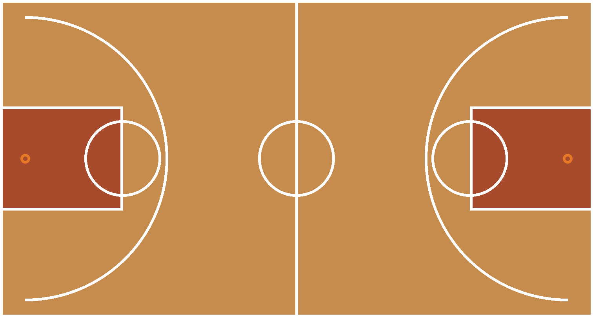

# Drone RL from zero: a full walkthrough

This is the complete, step-by-step version of this project: from a clean machine with nothing
installed, to a simulated drone that learns to hover, to a virtual basketball court it can fly
around in, to a harder task where it has to find a hoop that could be anywhere in a small room,
to a website where you can watch and steer all of that without writing any code.

It's written for someone who hasn't necessarily done machine learning before. A few terms get a
plain-language definition the first time they show up, and every command is copy-pasteable.

Every command here was run on **Windows 11, an ASUS Zenbook 14 (no NVIDIA GPU)**. Notes for
macOS/Linux are inline where they differ.

**What "reinforcement learning" means in this project:** instead of writing exact flight
instructions (turn the left motor up by this much, tilt forward by that much), we let the drone
try things inside a physics simulator, over and over, and give it a numeric reward each time
based on how well it did. A learning algorithm gradually adjusts the drone's decision-making (its
"policy") so it collects more reward over time. After enough attempts, without any human ever
writing down the actual flying technique, the drone has learned one on its own.

**Contents**

1. [Pick a simulator: PyBullet vs MuJoCo](#1-pick-a-simulator)
2. [Install everything](#2-install-everything)
3. [Sanity check](#3-sanity-check)
4. [Task 1: teach the drone to hover](#4-task-1-teach-the-drone-to-hover)
5. [Visualize it: build a basketball court](#5-visualize-it-build-a-basketball-court)
6. [Task 2: find a hoop in a 2x2x2 m room](#6-task-2-find-a-hoop-in-a-2x2x2-m-room)
7. [The easy way to play with it: the web dashboard](#7-the-easy-way-to-play-with-it-the-web-dashboard)
8. [Troubleshooting](#8-troubleshooting)
9. [Where to go next](#9-where-to-go-next)

---

## 1. Pick a simulator

| | **PyBullet** (`gym-pybullet-drones`) | MuJoCo |
|---|---|---|
| Ready-made quadrotor environment | Yes: a Crazyflie model, a standard RL interface (Gymnasium), example training scripts, and a built-in flight controller | No maintained drone package; you'd build the environment yourself first |
| Physics | Fine for rigid-body drone dynamics | Better at contacts, a bit faster |
| Time to first trained agent | About 20 minutes including install | Hours of scaffolding before you can even start training |

For a first RL-on-drones project, PyBullet wins because the environment already exists. We use
[`gym-pybullet-drones`](https://github.com/utiasDSL/gym-pybullet-drones) (the `utiasDSL` /
`learnsyslab` version, v2.2.0).

---

## 2. Install everything

### 2.1 Prerequisites

You need three things on the machine before you start:

| tool | why | Windows | macOS | Linux |
|---|---|---|---|---|
| **Miniconda / Anaconda** | manages an isolated Python environment | [installer](https://docs.conda.io/en/latest/miniconda.html) | `brew install --cask miniconda` | [installer](https://docs.conda.io/en/latest/miniconda.html) |
| **Git** | to clone the simulator | [git-scm.com](https://git-scm.com) | `brew install git` | `apt install git` |
| **A C++ compiler** | `pybullet` has no ready-made install for Python newer than 3.10, so `pip` builds it from source on your machine | [VS Build Tools](https://visualstudio.microsoft.com/downloads/), pick "Desktop development with C++" | Xcode command line tools: `xcode-select --install` | `sudo apt install build-essential` |

Check the first two are visible from a terminal:

```bash
conda --version
git --version
```

There's no simple one-line check for the C++ compiler. You'll find out in the next step if it's
missing, from an error like `error: Microsoft Visual C++ 14.0 or greater is required`.

### 2.2 Create the environment

```bash
# clone the simulator
git clone https://github.com/utiasDSL/gym-pybullet-drones.git
cd gym-pybullet-drones

# gym-pybullet-drones 2.2.0 needs Python 3.12 or newer.
# Using the conda-forge channel avoids a Terms-of-Service prompt from Anaconda's own channel.
conda create -n drones -c conda-forge --override-channels python=3.12 -y
conda activate drones

# conda-forge's python=3.12 ships without pip, so add it
conda install -c conda-forge --override-channels pip setuptools wheel -y

# install the package and every dependency
# (this compiles pybullet from source and downloads PyTorch, about 124 MB;
#  allow 10 to 20 minutes)
pip install -e .
```

What lands in the environment (see [`../requirements-lock.txt`](../requirements-lock.txt) for
exact version pins):

| package | version | role |
|---|---|---|
| `torch` | 2.14.0 **+cpu** | the neural network library (CPU only: no NVIDIA GPU on this laptop) |
| `stable-baselines3` | 2.9.0 | the RL algorithm implementations (PPO and friends) |
| `gymnasium` | 1.3.0 | the standard RL environment interface |
| `pybullet` | 3.2.7 | the physics engine (built from source) |
| `gym-pybullet-drones` | 2.2.0 | the quadrotor environments themselves |

> **`conda activate drones` says `EnvironmentNameNotFound`?** Your shell's `conda` command and
> the environment were installed by different tools (for example, Anaconda vs Miniconda). Fix it
> once with `conda config --append envs_dirs <path>\Miniconda3\envs`, or activate by the full
> path, or just call that environment's Python directly:
> `& "<path>\envs\drones\python.exe" script.py`.

### 2.3 Install ffmpeg (needed for any recorded video)

```bash
conda install -n drones -c conda-forge --override-channels ffmpeg -y
```

Every place in this project that records a video, PyBullet's built-in recorder, the webapp's
replay generator, uses `ffmpeg` under the hood, and it fails completely silently if `ffmpeg`
isn't installed: no error, just an empty output folder or a video file a fraction of a second
long. This was actually discovered the hard way partway through this project (see
[PROGRESS.md](../PROGRESS.md)), so save yourself the confusion and install it now.

### 2.4 Install the web dashboard's extra packages

```bash
conda activate drones
pip install fastapi "uvicorn[standard]" psutil
```

These aren't needed for training or evaluating from the command line, only for the web dashboard
in [section 7](#7-the-easy-way-to-play-with-it-the-web-dashboard). Installing them now means
everything is ready by the time you get there.

### 2.5 (Optional) Install Jupyter

Only needed if you want to open or re-run `tutorial/walkthrough.ipynb` yourself.

```bash
conda activate drones
pip install jupyter nbconvert ipykernel
```

---

## 3. Sanity check

```bash
python -c "import pybullet, torch, stable_baselines3, gymnasium; \
from gym_pybullet_drones.envs.HoverAviary import HoverAviary; \
print('torch', torch.__version__, 'cuda', torch.cuda.is_available()); \
e = HoverAviary(); e.reset(); print('env OK'); e.close()"
```

Expected output:

```
torch 2.14.0+cpu cuda False
...
env OK
```

`cuda False` is correct here: training runs on the CPU, which is fine because the neural network
involved is tiny.

---

## 4. Task 1: teach the drone to hover

### 4.1 Understand the environment

We start with **`HoverAviary`**: one Crazyflie 2.X quadrotor whose job is to reach and hold
`(0, 0, 1.0)` metres (one metre straight up from where it starts) for an 8-second episode.

Three terms that come up constantly from here on:

- **Observation**: what the drone "sees" each step, as a list of numbers. For `HoverAviary` this
  is 27 numbers: position, orientation, linear and angular velocity, plus a short memory of its
  recent actions.
- **Action**: what the drone decides to do each step. For this first task it's a single number
  between -1 and 1, applied as the same RPM change to all four motors at once, so the drone can
  only move straight up or down, not sideways. That's deliberately the simplest possible choice,
  and it makes hovering fast to learn.
- **Reward**: a score computed each step from how close the drone currently is to the goal.
  Training tries to maximise the total reward over an episode. For this task, about 474 over one
  episode means the drone sat almost perfectly still on the target the whole time; the training
  script treats 474 as "solved."

```python
from gym_pybullet_drones.envs.HoverAviary import HoverAviary
from gym_pybullet_drones.utils.enums import ObservationType, ActionType

env = HoverAviary(obs=ObservationType.KIN, act=ActionType.ONE_D_RPM)
print(env.observation_space)   # Box(..., (1, 27), float32)
print(env.action_space)        # Box(-1.0, 1.0, (1, 1), float32)
```

(Richer action spaces exist too: `rpm` controls all four motors independently, `pid` takes a
position to fly to, `vel` takes a direction and a speed. We come back to why the choice of action
space matters a lot in [section 6](#6-task-2-find-a-hoop-in-a-2x2x2-m-room).)

### 4.2 Run the first training script

The full script is [`../scripts/quickstart_train.py`](../scripts/quickstart_train.py). The
important parts:

```python
from stable_baselines3 import PPO
from stable_baselines3.common.env_util import make_vec_env
from stable_baselines3.common.callbacks import EvalCallback, StopTrainingOnRewardThreshold
from gym_pybullet_drones.envs.HoverAviary import HoverAviary
from gym_pybullet_drones.utils.enums import ObservationType, ActionType

OBS, ACT = ObservationType.KIN, ActionType.ONE_D_RPM

# 4 copies of the environment running at once, so PPO collects experience faster
train_env = make_vec_env(HoverAviary, env_kwargs=dict(obs=OBS, act=ACT), n_envs=4, seed=0)
eval_env  = make_vec_env(HoverAviary, env_kwargs=dict(obs=OBS, act=ACT), n_envs=1, seed=1)

model = PPO("MlpPolicy", train_env, verbose=1)   # PPO with default settings

# stop as soon as the policy is good enough
stop = StopTrainingOnRewardThreshold(reward_threshold=474.0, verbose=1)
eval_cb = EvalCallback(eval_env, callback_on_new_best=stop,
                       best_model_save_path="../results", log_path="../results",
                       eval_freq=2000, n_eval_episodes=5, deterministic=True)

model.learn(total_timesteps=300_000, callback=eval_cb)
model.save("../results/final_model.zip")
```

Run it:

```bash
cd path/to/CMS/scripts
python quickstart_train.py            # runs with no window, about 7 minutes, stops early once solved
```

On this laptop it solved hover in 160,000 steps, about 6.5 minutes of CPU time, and stopped
early. Along the way, `EvalCallback` writes `results/best_model.zip` every time it beats its own
record, plus `results/evaluations.npz` (a log of reward vs. training steps).

> Stable-Baselines3 buffers its console output, so the terminal can look frozen for a minute at a
> time. That's normal, it's still working.

**Want to watch it learn live instead of headless?**

```bash
python quickstart_train.py --watch    # opens a PyBullet window; slower, 1 environment instead of 4
```

### 4.3 Watch and evaluate

**Score the saved policy** (no window, about 30 seconds), using
[`../scripts/quickstart_eval.py`](../scripts/quickstart_eval.py):

```bash
python quickstart_eval.py
```

This runs 20 episodes, prints the mean reward, and saves `results/hover_trajectory.png` (altitude
and horizontal drift over one flight).

**Watch the trained drone fly**, in a PyBullet window:

```bash
python -m gym_pybullet_drones.examples.play --model_path ../results/best_model.zip
```

### 4.4 Read the results

From `results/evaluations.npz`:

| training steps | mean reward |
|---:|---:|
| 8k | 336 |
| 16k | 441 |
| 40k | 219 (a PPO wobble, it recovered) |
| 104k | 466 |
| 160k | 474, early stop |

The dip near 40k is ordinary early-training variance, not a bug; the official example just trains
for 10 million steps to ride it out. Lowering PPO's learning rate to `1e-4` smooths it out if it
bothers you.

Final policy: **474.1 ± 0.0** over 20 episodes. The drone climbs to 1.0 m and holds it with
drift measured in millimetres.

---

## 5. Visualize it: build a basketball court

[`../scripts/court.py`](../scripts/court.py) does two things.

**(a) Draws the markings** into a texture image with PIL: a top-down FIBA-style court with the
boundary line, halfway line, centre circle, both keys, free-throw circles, and three-point arcs.

**(b) Builds the 3D scene** inside a running PyBullet world, using the same simulator instance the
environment is already using (`env.getPyBulletClient()`):

```python
import pybullet as p

# textured floor slab
floor = p.createMultiBody(0, floor_col, floor_vis, [0, 0, -0.01])
tex = p.loadTexture("court_texture.png")
p.changeVisualShape(floor, -1, textureUniqueId=tex)

# each hoop is a pole (cylinder), a backboard (box), and a ring of small orange spheres for the rim
```

A real court is 28 by 15 metres with a 3.05 m rim, far too big next to a drone that hovers at
1 m, so `build_court(client, scale=0.5)` shrinks everything down: a 14 by 7.5 m court with the
rim at about 1.5 m, right in the drone's working range.

**Fly a tour of it** with [`../scripts/fly_in_court.py`](../scripts/fly_in_court.py). It builds a
plain simulation (no RL involved), drops the court in, and flies a waypoint tour using
`DSLPIDControl`, the classic PID position controller that ships with `gym-pybullet-drones`:

```bash
python fly_in_court.py            # PID tour, opens a window
python fly_in_court.py --record   # also saves results/video-*.mp4
python fly_in_court.py --scale 0.4   # a smaller court
python fly_in_court.py --rl       # the trained hover policy, dropped into the court
```

`--rl` loads `best_model.zip`, but since that policy was trained with the single-scalar-thrust
action space, it can only hold altitude. It hovers at centre court rather than flying the tour.
Making the RL agent actually fly a course needs a richer action space, which is exactly what
section 6 does.



---

## 6. Task 2: find a hoop in a 2x2x2 m room

### 6.1 Why a new task

The eventual real-world demo flies inside a netted volume only **2 by 2 by 2 metres**. That's far
too small for even a shrunk basketball court: scaling the court down to fit would put the rim
about 22 centimetres off the floor, which isn't a meaningful basketball hoop anymore. So instead
of reusing the court, [`../scripts/hoop_env.py`](../scripts/hoop_env.py) defines a dedicated
task, `HoopFindAviary`: one hoop, sized to fit the small room, that the drone has to fly to.

### 6.2 The design

Two things make this harder, and more realistic, than the hover task:

- **The hoop moves.** Its position, and the drone's own starting position, are picked at random
  every single episode. This forces the policy to learn to search for the hoop, rather than
  memorising one fixed flight path.
- **The drone has to be told where the hoop is.** The observation includes a vector pointing from
  the drone to the hoop. Without that, the task would be unsolvable, not because it's hard, but
  because it's genuinely impossible: it would be like asking someone to find a light switch in a
  pitch-dark, unfamiliar room with no directions at all. Giving no information isn't a fair
  difficulty setting, it removes the possibility of success entirely.

### 6.3 A real bug, and how it was found

The first attempt used the `pid` action space (the one where the drone's action is "fly to this
exact position"). It seemed like the obvious choice: the whole task is "go to this position."

After 400,000 training steps, the result was checked properly, not just by looking at the reward
number, but by actually counting how many of 20 test episodes reached the hoop:

**0 out of 20.** Not close. Something was wrong.

The fix came from watching the drone step by step rather than trusting the summary reward alone.
Doing that revealed the drone was tipping itself over and crashing within about 8 control steps
of every single episode, before it had moved almost anywhere.

The root cause: `pid`'s action is an exact destination in metres, and the underlying flight
controller only moves the drone up to 1 metre per control step (about 33 milliseconds) toward
that destination. In a room this small, an untrained policy very often asks for a destination
more than 1 metre away from where the drone currently is, meaning it's effectively asking the
drone to teleport almost a full metre in a thirtieth of a second. The flight controller responds
to that impossible request with a violent tilt, trying to accelerate hard enough to keep up, and
the drone tips over and crashes before it has flown almost anywhere. The policy never got the
chance to learn anything about actually finding the hoop; all it could learn was how to fall over
slightly more slowly.

The fix was to switch to the `vel` action space, where the drone's action is a direction to move
in and a speed to move at (a fraction of its top speed, about 0.25 m/s), much closer to how you'd
actually steer a real drone with a joystick. Before spending time retraining, this was checked
with a simple hand-written policy (just always fly straight toward the target) to confirm the
drone now flew smoothly with no tumbling. It did. Only then was the full training run repeated.

Result after 500,000 steps with `vel`: **9 out of 20** episodes reach the hoop, and the average
final distance to the hoop dropped from 0.84 m to 0.34 m. Training was still improving, not fully
plateaued, when this was last checked, so more training steps would likely help further. The full
technical write-up, including the exact numbers checked at each stage, is in
[PROGRESS.md](../PROGRESS.md) and in `hoop_env.py`'s own comments.

The lesson worth keeping in mind for any RL project: a summary number like "average reward" can
look like it's slowly improving while the policy has actually learned nothing useful. Always
spot-check a handful of individual episodes, not just the headline number.

### 6.4 Run it

```bash
cd path/to/CMS/scripts

# train (this is a harder task than hover, no known "solved" reward threshold yet;
# budget the number of timesteps yourself)
python train_hoop_find.py
python train_hoop_find.py --watch     # see it during training

# watch the trained policy chase a hoop that moves every episode
python fly_hoop_demo.py
python fly_hoop_demo.py --episodes 5
python fly_hoop_demo.py --record      # saves results/video-*.mp4
```

### 6.5 Results

Evaluated over 20 episodes with fresh, unseen random hoop and start positions:

| | First attempt (`pid`, 400k steps) | Current (`vel`, 500k steps) |
|---|---:|---:|
| Reached the hoop | 0/20 | **9/20** |
| Mean final distance to hoop | 0.84 ± 0.34 m | **0.34 ± 0.22 m** |

---

## 7. The easy way to play with it: the web dashboard

Everything so far has meant running Python scripts from a terminal. The web dashboard wraps the
hoop-finding task in a local website instead: point-and-click controls, a live 3D view, and no
code required once it's running. This is the part built specifically to be easy for someone who
isn't a programmer.

### 7.1 Launch it

```bash
conda activate drones
cd path/to/CMS/webapp
python -m uvicorn main:app --app-dir backend --port 8000
```

Then open `http://localhost:8000` in your browser. Stop the server with Ctrl+C in the terminal
when you're done.

If your terminal shows `(drones)` in the prompt and `uvicorn` still isn't found as a plain
command, that's a PATH issue, not a missing package: use the `python -m uvicorn` form above, it
sidesteps that entirely. See [section 8](#8-troubleshooting) if you hit anything else.

### 7.2 A guided tour

**The 3D view**, in the middle of the page, shows the 2x2x2 m cage as a wireframe box, the hoop,
and the drone. Drag to rotate the view, scroll to zoom.

**Setting a start position**, in the right-hand panel: choose whether you're positioning the
Drone, the Hoop, or Both, then use the on-screen arrow buttons, or your keyboard's arrow keys
(plus Page Up / Page Down for height), to move the selected marker around. A "Randomize with
seed" checkbox is ticked by default, meaning the position you see is ignored and a random one is
generated instead, using whatever seed number is in the box next to it. Untick it to use the
exact position you set by hand.

**Picking an algorithm**: a dropdown lets you choose which learning algorithm trains the drone.
In plain terms, these are different strategies for learning from trial and error:

- **PPO**: the one used for every result in this document so far, and the most tested here.
- **A2C, SAC, TD3**: other established algorithms, all usable on the same continuous
  direction-and-speed controls as PPO.
- **DQN**: needs the drone's choices simplified to a fixed set of 7 moves (six directions plus
  "hover") rather than a smooth direction and speed, because DQN can only choose from a fixed
  list of options rather than a continuous range. The dashboard shows a note about this when DQN
  is selected. It will likely need more training steps and may not reach as high a reward as the
  others.

**Starting and stopping**: set how many timesteps to train for and how many copies of the
simulation to run in parallel (sensible defaults are already filled in), then click "Start
training." The run appears in the list on the left, the drone starts moving live in the 3D view,
and a reward chart on the right fills in as the training script periodically checks how well it's
doing. Click "Stop" at any time; the model trained so far is still saved.

**Watching it learn**: the reward chart plots the current run against the best run recorded so
far, so you can see at a glance whether a new run is doing better or worse. A "Show live onboard
view" checkbox turns on the drone's own onboard camera feed, showing what the drone itself would
see; it's off by default because rendering it costs real computer time.

**Generating a replay video**: once a run is idle or finished, select it in the list, optionally
tick "Include drone POV," then click "Generate current replay" or "Generate best replay." After a
short wait, a video appears with normal play controls, and (if you asked for POV) a toggle to
switch between a third-person view and the drone's own onboard view.

### 7.3 What's actually happening behind the scenes

The dashboard's backend never imports PyTorch, PyBullet, or Stable-Baselines3 itself. When you
click "Start training," it just launches
[`../scripts/train_hoop_multi.py`](../scripts/train_hoop_multi.py) as a separate process, the
same `HoopFindAviary` environment from section 6, just with a choice of algorithm and a
run-specific output folder. That script writes small status files as it goes
(`results/hoop/runs/<run_id>/meta.json`, `live_status.json`, `telemetry.jsonl`), and the
dashboard just reads them back. That folder is the entire "database," there's no separate
registry anywhere, so restarting the dashboard never loses anything: it just re-reads whatever is
already on disk.

---

## 8. Troubleshooting

**`conda activate drones` says `EnvironmentNameNotFound`.** Your shell's `conda` command and the
`drones` environment come from different installs (for example, Anaconda vs Miniconda). Fix it
once with `conda config --append envs_dirs <path>\Miniconda3\envs`, activate by the full path
instead, or call that environment's Python directly:
`& "<path>\envs\drones\python.exe" script.py`.

**`uvicorn` isn't found, even in an activated `(drones)` prompt.** This is a PATH problem in that
particular terminal, not a missing package. Run it as a module instead:
`python -m uvicorn main:app --app-dir backend --port 8000`. If even `python` resolves to the
wrong install, use the full path to the environment's Python:
`& "<path>\envs\drones\python.exe" -m uvicorn main:app --app-dir backend --port 8000`.

**Recorded or replay videos are empty, or only last a fraction of a second.** `ffmpeg` isn't
installed in the `drones` environment. Run
`conda install -n drones -c conda-forge --override-channels ffmpeg -y` (see
[section 2.3](#23-install-ffmpeg-needed-for-any-recorded-video)).

**Creating the conda environment asks you to accept Anaconda's Terms of Service.** Use the
conda-forge channel instead of the default one, as shown in the install steps:
`conda create -n drones -c conda-forge --override-channels python=3.12 -y`.

**There's a `Drone/` folder in the repository root.** Ignore it. It's an old, unused virtual
environment from early on in the project, not part of the current setup described here.

---

## 9. Where to go next

A few open threads: how many more training steps the hoop-finding task needs before it stops
improving, whether a denser reward (one that rewards getting closer even before reaching the
hoop, not just a bonus on arrival) would speed that up, and which real drone hardware the 2x2x2 m
cage demo eventually runs on. The full, up-to-date list of what's done, what's next, and what's
still an open question lives in [`../PROGRESS.md`](../PROGRESS.md), kept current as the project
moves rather than duplicated here.

---

*Companion notebook: [`walkthrough.ipynb`](walkthrough.ipynb) covers both tasks end to end,
training curves, full rollout diagnostics (position, orientation, velocity, and actions over
time), and embedded video, all already run and saved. Open it in Jupyter to see the results
without running anything, or re-run it yourself for fresh numbers.*
